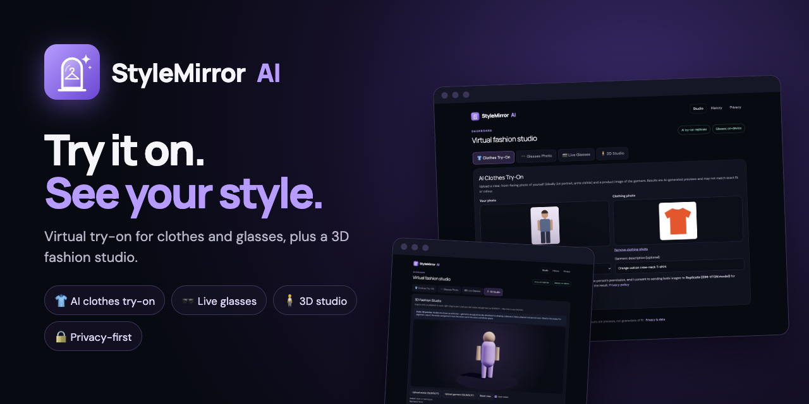
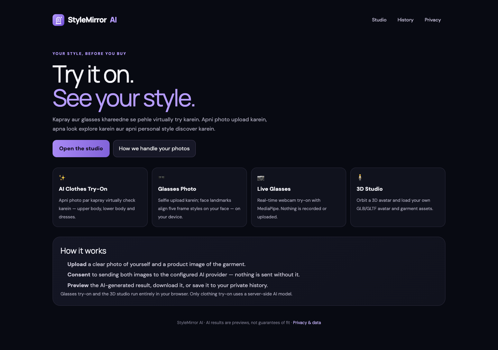
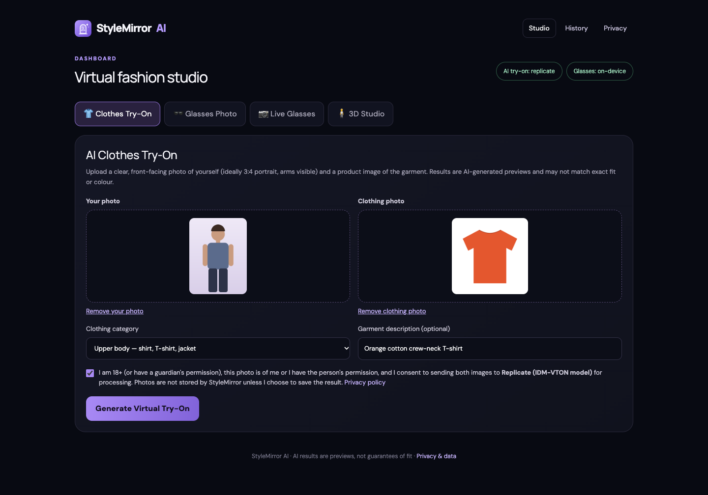
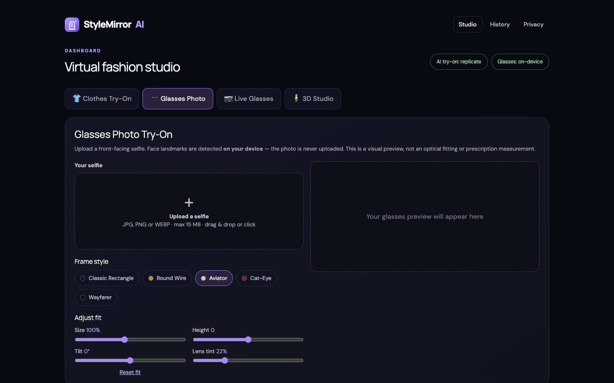
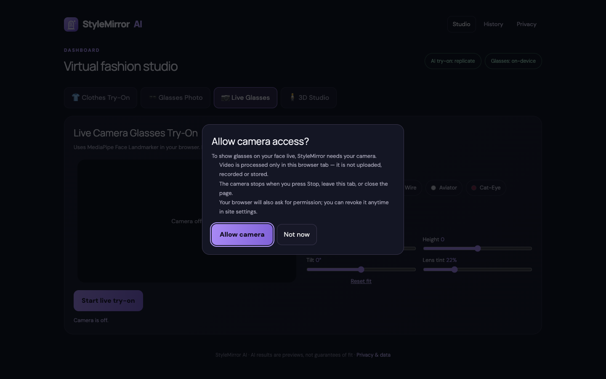
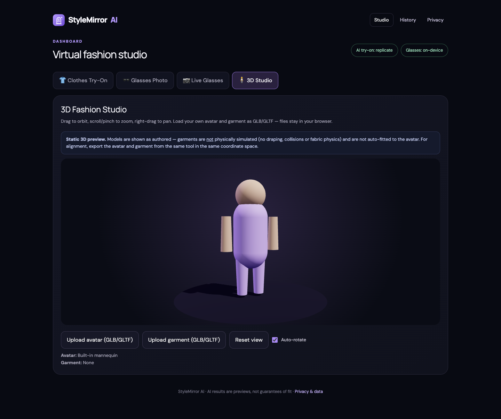
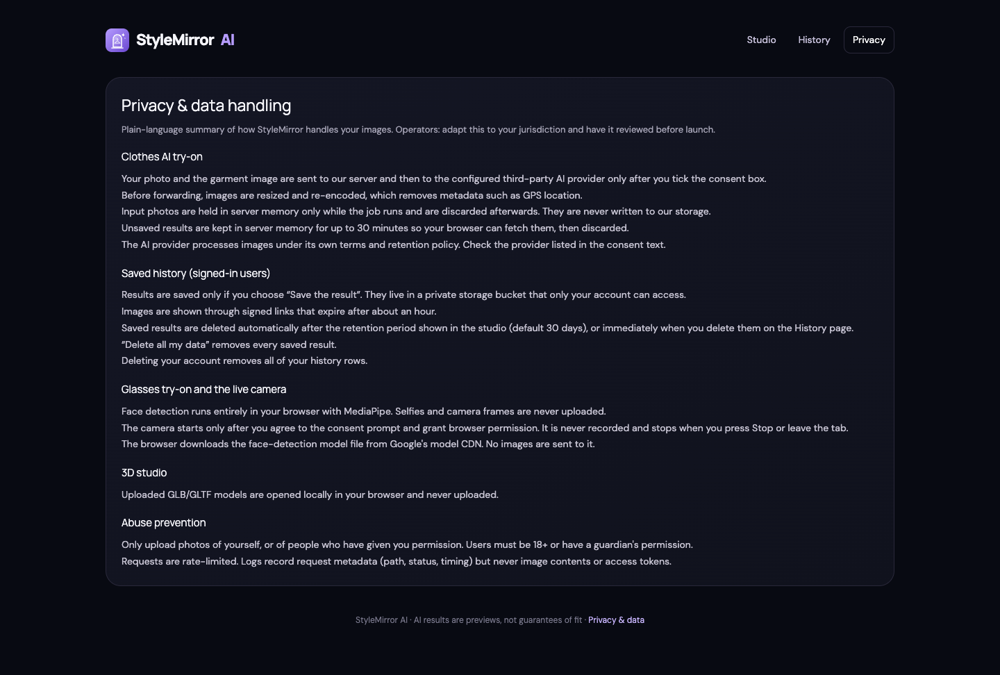
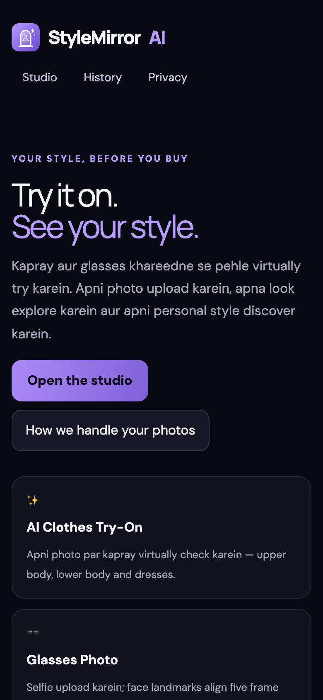
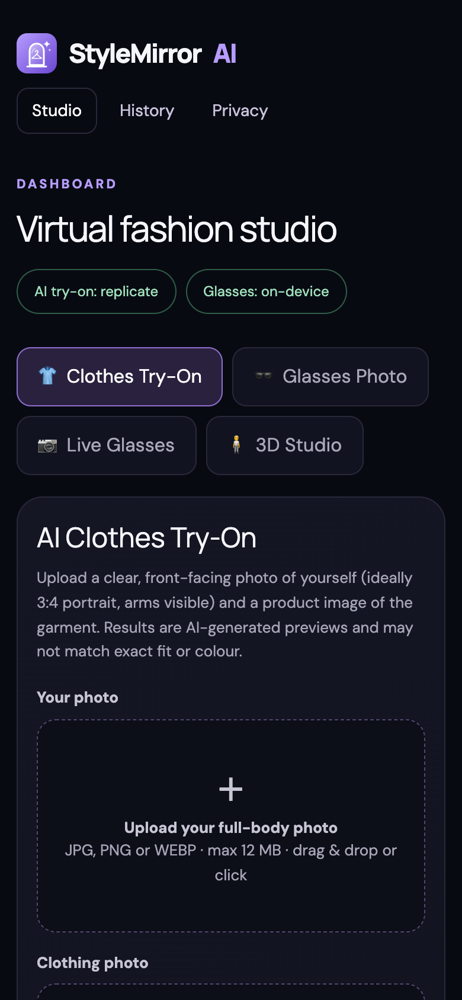

<p align="center">
  
</p>

<h1 align="center">StyleMirror AI</h1>

<p align="center"><b>Try it on. See your style.</b><br/>Virtual try-on for clothes and glasses, plus a 3D fashion studio.</p>

<p align="center">
  
  
  
  
  
  
</p>

<p align="center">
  
</p>

## About

StyleMirror AI lets shoppers preview clothes and glasses on themselves before they buy. Upload your photo and a garment for an AI try-on, try five glasses frame styles on a selfie or a live webcam, or inspect 3D avatars in the studio. Everything is privacy-first: AI processing needs explicit consent, and the glasses and 3D features never leave your browser.

**Category:** Shopping & Fashion (secondary: Lifestyle). Store-style copy, topics and screenshot captions are in [`LISTING.md`](LISTING.md).

## Screenshots

<table>
  <tr>
    <td align="center"><br/><sub>Landing page</sub></td>
    <td align="center"><br/><sub>AI clothes try-on with consent</sub></td>
  </tr>
  <tr>
    <td align="center"><br/><sub>Glasses photo: 5 frame styles and fit controls</sub></td>
    <td align="center"><br/><sub>Live glasses: camera consent first</sub></td>
  </tr>
  <tr>
    <td align="center"><br/><sub>3D fashion studio</sub></td>
    <td align="center"><br/><sub>Privacy and data handling</sub></td>
  </tr>
</table>

<p align="center">
  
  &nbsp;&nbsp;
  
</p>

<sub>Screenshots use illustrated sample images; no AI result is shown because generating one needs a live provider.</sub>

## Features

A virtual try-on platform with four modes:

- **AI clothes try-on.** Upload your photo and a garment photo, then pick upper body, lower body or dress. The backend runs an async job against a pluggable AI provider and shows progress, the result, download, retry and error states.
- **Glasses photo try-on.** MediaPipe face landmarks align 5 frame styles to a selfie. Size, height, tilt and tint are adjustable. Runs on-device.
- **Live glasses try-on.** Webcam plus MediaPipe Face Landmarker, with a consent dialog, a mirrored preview, and the camera stopping on Stop, tab hide or unmount. Nothing is recorded.
- **3D studio.** A Three.js viewer with OrbitControls. Load your own GLB/GLTF avatar and garment, with validation. It is a **static preview**, not cloth simulation.

Optional Supabase Auth adds a private, user-scoped try-on history with signed URLs, per-item and delete-all controls, and automatic retention.

> **No fake results.** If no provider is configured, the UI says so and the API returns `503 provider_not_configured`. A job succeeds only when the provider returns a real, verified image.

> **Licence warning.** The bundled Replicate adapter uses IDM-VTON, which is **CC BY-NC-SA 4.0 (non-commercial)**. For a commercial product, use a commercially licensed provider. See [docs/PROVIDERS.md](docs/PROVIDERS.md).

## Structure

```
backend/                FastAPI API
  app/config.py         env settings (all secrets server-side)
  app/images.py         upload validation + EXIF-stripping normalisation
  app/providers/        adapter interface, generic HTTP, Replicate (IDM-VTON)
  app/jobs.py           async job manager (progress, TTL, history save)
  app/supabase.py       Auth verification, Storage, history via PostgREST (RLS)
  app/routes/           /api/tryon/jobs, /api/tryon (legacy), /api/history
  tests/                pytest suite (providers mocked with httpx.MockTransport)
frontend/               Next.js 14 (App Router)
  app/                  / (landing), /studio, /history, /login, /privacy
  components/           ClothesTryOn, GlassesPhoto, LiveGlasses, ThreeStudio, …
  lib/                  api client + polling, glasses geometry, model validation
  test/                 Vitest + Testing Library
supabase/migrations/    SQL: tryon_history table, RLS, private bucket + policies
docs/                   API.md, PROVIDERS.md, DEPLOYMENT.md
```

## Requirements

- Node.js 20+
- Python 3.9+ (3.11+ recommended; the Docker image uses 3.12)
- Optional: a Supabase project, and a Replicate token or another try-on API

## Setup

### 1. Backend

macOS / Linux:
```bash
cd backend
python3 -m venv .venv
source .venv/bin/activate
pip install -r requirements-dev.txt
cp .env.example .env
uvicorn main:app --reload --port 8000
```

Windows (PowerShell):
```powershell
cd backend
py -m venv .venv
.venv\Scripts\Activate.ps1
pip install -r requirements-dev.txt
copy .env.example .env
uvicorn main:app --reload --port 8000
```

### 2. Frontend

```bash
cd frontend
npm install            # postinstall copies the MediaPipe WASM into public/
cp .env.local.example .env.local      # Windows: copy .env.local.example .env.local
npm run dev
```

Open http://localhost:3000. Glasses and 3D work immediately. Clothes try-on needs a provider (next step).

### 3. Connect a try-on provider

In `backend/.env`:
```env
TRYON_PROVIDER=replicate
REPLICATE_API_TOKEN=r8_your_token
```
Or use any compatible endpoint with `TRYON_PROVIDER=generic`, `TRYON_API_URL` and `TRYON_API_KEY`. The exact request and response schemas are in [docs/PROVIDERS.md](docs/PROVIDERS.md). Restart the backend; `/api/health` should show `"tryon_configured": true`.

### 4. Optional: accounts and history (Supabase)

1. Apply `supabase/migrations/20261115000000_tryon_history.sql` (`supabase db push`, or paste it into the SQL editor).
2. In `backend/.env`, set `SUPABASE_URL`, `SUPABASE_ANON_KEY` and `SUPABASE_SERVICE_ROLE_KEY`.
3. In `frontend/.env.local`, set `NEXT_PUBLIC_SUPABASE_URL` and `NEXT_PUBLIC_SUPABASE_ANON_KEY`.
   **Never** put the service-role key in the frontend.
4. Add `http://localhost:3000/studio` to Supabase Auth's redirect URLs.

## Quality checks

```bash
cd backend && ruff check . && ruff format --check . && mypy app main.py && pytest
cd frontend && npm run lint && npm run typecheck && npm test && npm run build
```

## Security and privacy design

- Provider and Supabase service keys live only in `backend/.env`. The browser gets only the public anon key.
- Before a photo leaves the browser for AI processing, the user ticks an explicit consent box. The server enforces this too (`consent=true`).
- Images are type-checked by content (not just MIME type), size- and pixel-limited, auto-rotated and re-encoded. Re-encoding strips EXIF/GPS.
- Inputs are never persisted. Unsaved results are dropped after 30 minutes. Saved results go to a private bucket, are served through 1-hour signed URLs, and are auto-deleted after `HISTORY_RETENTION_DAYS`.
- History reads and deletes run with the user's own token, so Postgres RLS enforces ownership. Inserts are server-only.
- Abuse prevention: per-IP and per-user rate limits, a cap on active jobs per client, a global concurrency cap, and an upload size guard before parsing.
- Glasses and live camera run fully on-device. The camera starts only after a consent dialog, is never recorded, and stops when the tab is hidden.
- Security headers on both apps: CSP, X-Frame-Options, nosniff, Referrer-Policy, Permissions-Policy, and HSTS in production. Request IDs are logged without tokens or image data.
- HTTPS is required in production (and for webcam access).

See [docs/API.md](docs/API.md) for endpoints and curl examples, [docs/DEPLOYMENT.md](docs/DEPLOYMENT.md) for hosting, and [docs/HOSTINGER.md](docs/HOSTINGER.md) for static hosting on Hostinger/cPanel (`npm run build:static`).

## Known limitations

- Jobs and rate limits are in memory, so run a single backend instance (see DEPLOYMENT.md for scaling).
- Glasses are 2D overlays aligned to landmarks. There is no 3D head occlusion and no optical or prescription fitting.
- The 3D studio does not simulate cloth or auto-fit garments to avatars. Assets must be authored in the same coordinate space.
